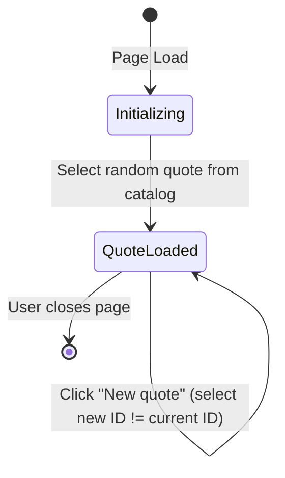
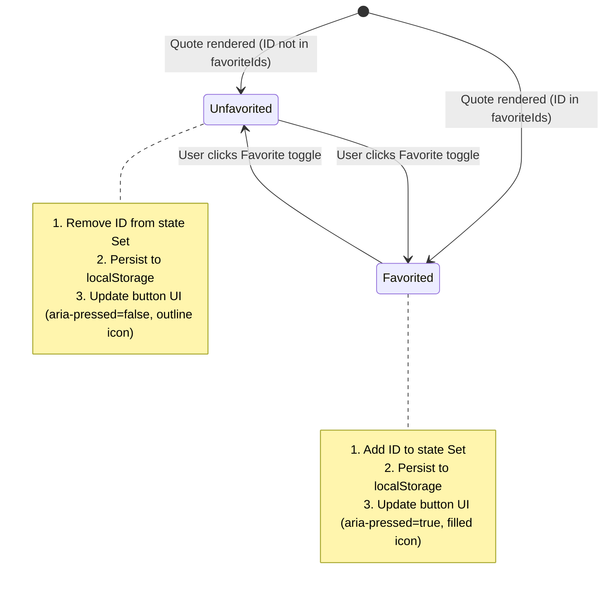

# Data Model: Quote of the Day Page

**Feature**: `001-quote-of-the-day`  
**Date**: 2026-10-14  
**Status**: Ready for Implementation  

---

## 1. Entities

### 1.1 Quote Entity
Represents an individual inspirational quote in the built-in catalog.

```typescript
interface Quote {
  /** Unique identifier for the quote (e.g., "q-001") */
  id: string;

  /** The core text content of the quote */
  text: string;

  /** Author attribution (e.g., "Ada Lovelace"). Defaults to "Unknown" if missing */
  author: string;
}
```

#### Validation Rules
- `id`: Non-empty string, must be unique within the catalog array (e.g., `q-001` through `q-010`).
- `text`: Non-empty string, trimmed length $\ge 1$.
- `author`: Non-empty string.
- **Catalog Invariant (FR-002, SC-006)**: The built-in catalog contains an immutable array of exactly 10 quotes, each with valid `id`, `text`, and `author`.

---

### 1.2 FavoriteState Entity
Represents the in-memory and persisted state of user favorites.

```typescript
interface FavoriteState {
  /** Set of quote IDs that are currently favorited by the user */
  favoriteIds: Set<string>;

  /** Whether the storage mechanism is active (localStorage) or degraded (in-memory only) */
  isPersistent: boolean;
}
```

---

### 1.3 LocalStorage Schema (Persistence Model)
The structure serialized to and deserialized from `window.localStorage`.

- **Storage Key**: `qotd_favorites_v1`
- **Serialized Format**: JSON string representing an array of quote IDs:
  ```json
  [
    "q-001",
    "q-007",
    "q-014"
  ]
  ```

#### Storage Validation Rules
- Must be a valid JSON string.
- Deserialized root must be an Array.
- Every item in the array must be a non-empty string.
- If corrupted or non-compliant, parser safely falls back to `[]` and reports a warning.

---

## 2. State Transitions

### 2.1 Quote Display Lifecycle


### 2.2 Favorite Toggle Lifecycle

