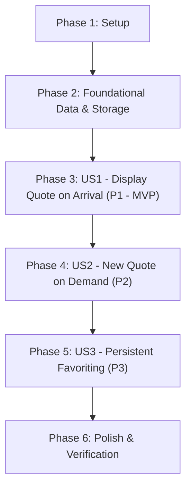

# Tasks: Quote of the Day Page

**Feature**: `001-quote-of-the-day`  
**Input**: Design artifacts from `specs/001-quote-of-the-day/` (`spec.md`, `plan.md`, `data-model.md`, `contracts/`, `quickstart.md`)  
**Status**: Ready for Implementation  

---

## Phase 1: Setup (Shared Infrastructure)

**Purpose**: Project initialization and basic structure

- [X] T001 Initialize package configuration with ES module support, test script (`node --test tests/**/*.test.js`), and install `jsdom` dev dependency in `package.json`
- [X] T002 Create project directory structure (`src/data/`, `src/services/`, `tests/unit/`, `tests/integration/`) per implementation plan
- [X] T003 [P] Create responsive stylesheet layout with base typography, colors, and layout variables in `styles.css`

---

## Phase 2: Foundational (Blocking Prerequisites)

**Purpose**: Core data and storage infrastructure that MUST be complete before ANY user story can be implemented

**⚠️ CRITICAL**: No user story work can begin until this phase is complete

- [X] T004 [P] Create immutable 10-quote catalog in `src/data/quotes.js` quoting constraints verbatim: `id` (non-empty string, unique within catalog array `q-001` through `q-010`), `text` (non-empty string, trimmed length $\ge 1$), `author` (non-empty string), and catalog invariant of exactly 10 quotes (FR-002, SC-006)
- [X] T005 [P] Implement `StorageService` in `src/services/storage.js` with `localStorage` key `qotd_favorites_v1`, JSON serialization/deserialization, defensive corruption recovery falling back to empty set, and in-memory `Set<string>` fallback on `SecurityError` or `QuotaExceededError`
- [X] T006 [P] Create unit tests for storage persistence and corruption recovery in `tests/unit/storage.test.js`
- [X] T007 Implement base `QuoteService` class in `src/services/quote-service.js` with constructor accepting catalog, `totalCount` getter, and fallback quote handling for boundary conditions

**Checkpoint**: Foundation ready - user story implementation can now begin in parallel or sequentially.

---

## Phase 3: User Story 1 - Viewing a Quote upon Arrival (Priority: P1) 🎯 MVP

**Goal**: When user visits or opens the page, immediately display a random quote with text and author attribution from the 10-quote catalog in the main view.

**Independent Test**: Load the page in a fresh browser session; verify that a complete quote and its author are displayed immediately in `#quote-text` and `#quote-author`.

### Tests for User Story 1 ⚠️

> **NOTE: Write these tests FIRST, ensure they FAIL before implementation**

- [X] T008 [P] [US1] Write unit tests for initial quote selection in `tests/unit/quote-service.test.js` verifying that `getRandomQuote()` returns a valid entry from the catalog with non-empty `text` and `author`
- [X] T009 [P] [US1] Write integration tests in `tests/integration/app.test.js` verifying that application bootstrap renders quote text into `#quote-text` and author into `#quote-author` with `aria-live="polite"` on `#quote-card`

### Implementation for User Story 1

- [X] T010 [US1] Implement initial quote selection logic in `src/services/quote-service.js` returning a randomly selected quote from the catalog
- [X] T011 [US1] Create semantic HTML markup with `#quote-card` (`<article aria-live="polite">`), `#quote-text` (`<blockquote>`), and `#quote-author` (`<cite>`) in `index.html`
- [X] T012 [US1] Implement application bootstrap and DOM rendering in `src/app.js` to select and display the initial quote on DOMContentLoaded

**Checkpoint**: At this point, User Story 1 is fully functional and delivers an independent, viable MVP.

---

## Phase 4: User Story 2 - Requesting a New Quote on Demand (Priority: P2)

**Goal**: Allow users to click a "New quote" button to cycle to another quote without refreshing the whole page and without immediate consecutive repetitions.

**Independent Test**: With a quote currently visible, click "New quote" (`#new-quote-btn`) and confirm that a different quote and its author are displayed immediately.

### Tests for User Story 2 ⚠️

- [X] T013 [P] [US2] Write unit tests in `tests/unit/quote-service.test.js` asserting that `getRandomQuote(currentQuoteId)` never returns the identical quote consecutively when catalog length $\ge 2$
- [X] T014 [P] [US2] Write integration tests in `tests/integration/app.test.js` asserting that clicking `#new-quote-btn` replaces the displayed quote with a different quote and updates the author

### Implementation for User Story 2

- [X] T015 [US2] Implement anti-repetition selection algorithm in `src/services/quote-service.js` filtering out `currentQuoteId` from candidate pool of $N - 1 = 9$ quotes before selecting
- [X] T016 [US2] Add `#new-quote-btn` (`<button type="button" aria-label="Get a new quote">`) in `index.html` and wire click listener in `src/app.js`
- [X] T017 [US2] Add interactive button styles, hover/focus states, and active transitions in `styles.css`

**Checkpoint**: User Stories 1 and 2 work independently and together without full page reloads.

---

## Phase 5: User Story 3 - Favoriting and Unfavoriting with Persistence (Priority: P3)

**Goal**: User can toggle favorite status on any displayed quote; favorite state persists across reloads via `localStorage` (key: `qotd_favorites_v1`) with fallback to in-memory state if storage is restricted.

**Independent Test**: Favorite the currently displayed quote, reload page, navigate to that quote, and verify the favorite status remains active. Toggle the control again to verify it unfavorites properly.

### Tests for User Story 3 ⚠️

- [X] T018 [P] [US3] Write unit tests in `tests/unit/storage.test.js` verifying `toggleFavorite(quoteId)`, `isFavorite(quoteId)`, and persistence across new `StorageService` instances simulating page reloads
- [X] T019 [P] [US3] Write integration tests in `tests/integration/app.test.js` verifying that clicking `#favorite-btn` toggles `aria-pressed`, updates CSS class `is-favorited`, and preserves state on simulated reloads

### Implementation for User Story 3

- [X] T020 [US3] Add `#favorite-btn` (`<button type="button" aria-pressed="false" aria-label="Toggle favorite status">`) with `#favorite-icon` in `index.html`
- [X] T021 [US3] Implement favorite event handling and state synchronization in `src/app.js` (calling `StorageService.toggleFavorite`, updating `aria-pressed`, and syncing button state on quote changes)
- [X] T022 [US3] Add favorited state visual styles (`.is-favorited`, filled vs outline heart, active color, accessible focus outline) in `styles.css`

**Checkpoint**: All three user stories are functional and testable independently.

---

## Phase 6: Polish & Cross-Cutting Concerns

**Purpose**: Quality hardening, accessibility validation, and performance checks across all user stories

- [X] T023 [P] Add diagnostic logging for storage recovery and catalog status in `src/services/storage.js`
- [X] T024 [P] Add accessibility focus states, high-contrast borders, and mobile responsive layout tweaks in `styles.css`
- [X] T025 Execute end-to-end validation scenarios per `specs/001-quote-of-the-day/quickstart.md`
- [X] T026 Execute full automated test suite verifying $\ge 85\%$ coverage with zero failures via `tests/unit/` and `tests/integration/`

---

## Dependencies & Execution Order

### Phase Dependencies

- **Setup (Phase 1)**: No dependencies - can start immediately.
- **Foundational (Phase 2)**: Depends on Phase 1 - BLOCKS all user stories.
- **User Stories (Phase 3+)**: All depend on Phase 2 completion.
  - US1 (Phase 3): MVP milestone.
  - US2 (Phase 4): Enhances US1 with on-demand navigation.
  - US3 (Phase 5): Enhances US1 & US2 with personalization and persistence.
- **Polish (Phase 6)**: Depends on completion of all user story phases.

### User Story Dependencies

---

## Parallel Opportunities

- **Phase 1**: `T003` (CSS setup) can run in parallel with `T001`/`T002`.
- **Phase 2**: `T004` (quotes data), `T005` (storage service), and `T006` (storage tests) can proceed in parallel.
- **Phase 3 (US1)**: `T008` (quote service tests) and `T009` (DOM integration tests) can be authored in parallel before implementation.
- **Phase 4 (US2)**: `T013` (unit test) and `T014` (integration test) can be authored in parallel.
- **Phase 5 (US3)**: `T018` (storage tests) and `T019` (UI integration tests) can run in parallel.
- **Phase 6**: `T023` (logging) and `T024` (responsive/a11y CSS) can run in parallel.

---

## Implementation Strategy

### MVP First (User Story 1 Only)
1. Complete Phase 1: Setup (`T001`–`T003`).
2. Complete Phase 2: Foundational (`T004`–`T007`).
3. Complete Phase 3: User Story 1 (`T008`–`T012`).
4. **STOP and VALIDATE**: Verify initial quote display in browser and run `node --test tests/integration/app.test.js`. Deployable MVP ready!

### Incremental Delivery
1. Foundation complete (`T001`–`T007`).
2. Add US1 → Test independently → MVP milestone (`T008`–`T012`).
3. Add US2 → Test independently → Interactive exploration added (`T013`–`T017`).
4. Add US3 → Test independently → Persistent favoriting added (`T018`–`T022`).
5. Polish & Verification → End-to-end quickstart validation and coverage check (`T023`–`T026`).
